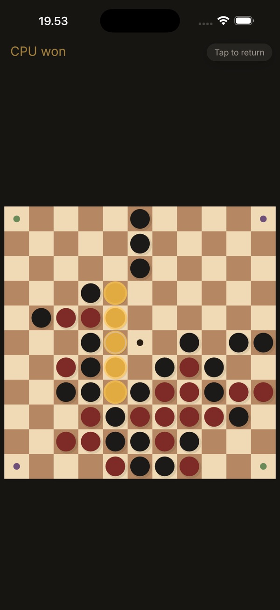
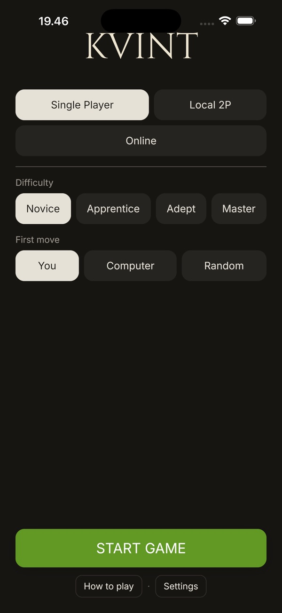

# Kvint

Kvint is a two player strategy game based on five in a row. I made the AI opponent from scratch in Rust using Monte Carlo tree search (MCTS).

It is free on the [App Store](https://apps.apple.com/dk/app/kvint/id6769683429).

<p align="center">
  
  
  
</p>

## Rules

The board is 11x11, and you can only place a pawn next to another pawn or in the middle of an edge. You win by getting five in a row, by placing a pawn in the center, or by holding two opposite corners.

## AI

The AI uses MCTS with random rollouts, and the difficulty is how many iterations it gets (from 1,000 to 500,000). The board is stored as two `u128` bitboards, so it is fast: 20,000 iterations from the start of a game takes about 30 ms on an M2.

## Playing

You can play against the AI, against a friend on the same device, or online. Online games are peer-to-peer and encrypted using [iroh](https://github.com/n0-computer/iroh), and you invite a friend with a QR code. The game is made with Bevy and runs on iOS and macOS.

To run it on desktop:

```bash
cargo run --release --bin kvint-desktop
```
